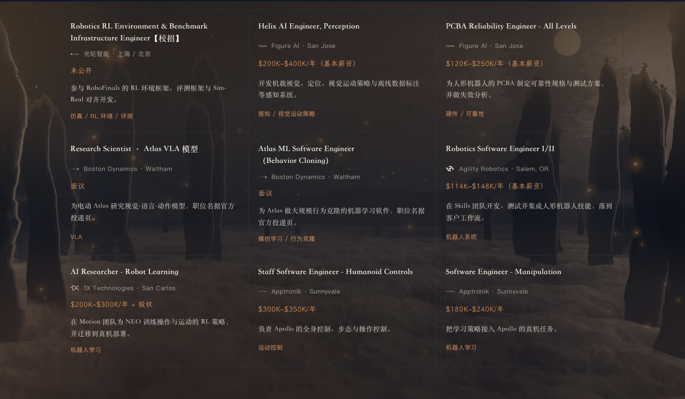
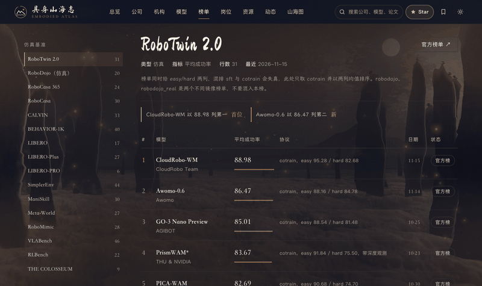
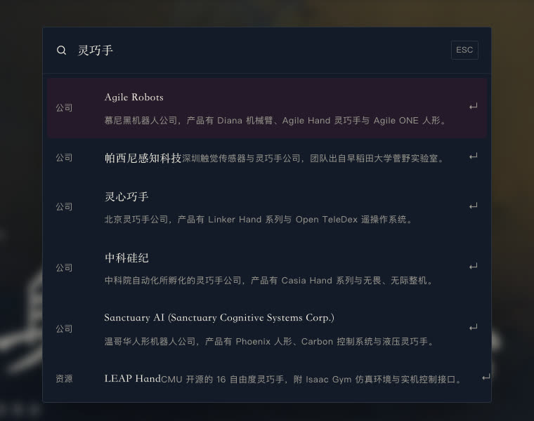
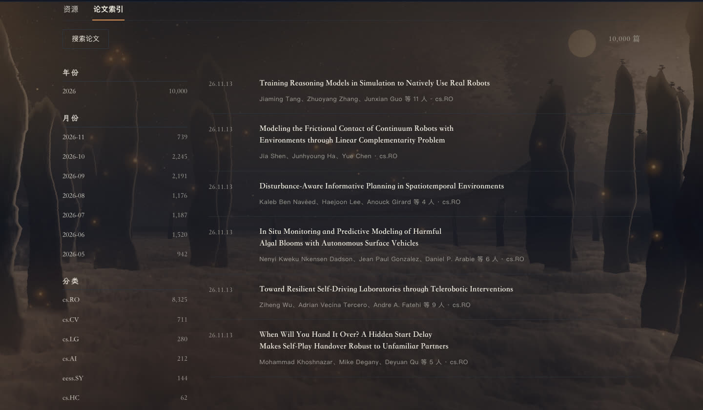

# 🏔️ 具身山海志

**具身之事，散于百家。今分七卷而志之，所录皆注出处，未可考者阙之。**

[🌐 入山](https://fbddcz.github.io/Embodied-Shanhai-Atlas/) · [🐛 纠错](https://github.com/FBddcz/Embodied-Shanhai-Atlas/issues/new?template=correction.yml) · [🏷️ 认领](https://github.com/FBddcz/Embodied-Shanhai-Atlas/issues/new?template=claim.yml) · [🤝 合作](https://fbddcz.github.io/Embodied-Shanhai-Atlas/coop.html)

## 📜 序

古之《山海经》，记某山多金玉，某水出焉，东流注于某泽，凡若干里。不言善恶，不论高下，读之者自知远近。

今之具身，亦一洪荒。人形、灵巧之手、视觉语言动作之模，一岁之间，立名号者百数。或称第一，查之官榜，无其名；或曰量产，求其交付，无其据；或悬一职，三月未撤，投书已无门。所闻愈多，所信愈少。

于是仿其体例，分七卷以志之。司、学、器、碑、职、经、驿，各归其山。每记一事，必注所出与核验之日；未可考者，留白，并书其所以留白。

所录未必尽是，所阙亦未必不可补。见其误者，幸为指之。

## 🧭 从哪里看起

| | 你在做什么 | 先看 | 再看 |
|:-:|---|---|---|
| 🔧 | 造本体 | [人间](https://fbddcz.github.io/Embodied-Shanhai-Atlas/companies.html) | 法器与灵材，藏经里的遥操作与数据 |
| 🧠 | 训模型 | [灵物](https://fbddcz.github.io/Embodied-Shanhai-Atlas/models.html) | 碑林里对应的榜，先看测法再看分 |
| 🦾 | 上真机 | [藏经 · 控制](https://fbddcz.github.io/Embodied-Shanhai-Atlas/resources.html#stage-6) | 部署、评测，再到真机榜 |
| 🎓 | 找工作 | [招贤](https://fbddcz.github.io/Embodied-Shanhai-Atlas/jobs.html) | 藏经里的课程，再看目标公司和实验室 |
| 📡 | 看行业 | [驿路](https://fbddcz.github.io/Embodied-Shanhai-Atlas/news.html) | [会期与投稿](https://fbddcz.github.io/Embodied-Shanhai-Atlas/events.html)，碑林近况 |

- ⌨️ 任一页按 <kbd>⌘K</kbd>（Windows 为 <kbd>Ctrl K</kbd>）搜全站
- ⚖️ [选型对比](https://fbddcz.github.io/Embodied-Shanhai-Atlas/compare.html)可以把三家公司或三个模型放在一张表里
- 📬 驿路页有 RSS 地址，可以用阅读器订阅

## 📐 凡例

一、**有出处方录。** 每条事实附原文链接与核验日期。查不到的，不估、不凑、不借邻条之数。

二、**分数必书其所出。** 一千一百六十二行成绩，取自官方榜者七百二十四，自报者四百三十八，各自标明。日后官方有撤下者，原分不删，划线存之。

三、**测法不同者不并列。** 每任务测五十回与测十回，仿真与真机，训练时是否用了同源数据，皆分而录之。

四、**图取本物。** 二百七十件法器，图皆出自厂商自己的产品页。九十一种灵物，几无官方之图，故一张不配，宁空不借。

五、**境界不收自述。** 称量产者，须见交付；称第一者，须见榜位。

---

## 🗺️ 海上七山

海上之山凡七，各有一兽镇之，各守一戒。

| | 卷 | 镇兽 | 戒 | 所志 |
|:-:|---|---|---|---|
| 🏛️ | **人间** | 驮山兽 | 不铸无主之器 | 公司 154 家，其中 108 家的融资有据可查 |
| 🎓 | **学宫** | 白泽 | 不立无据之说 | 实验室与研究院 60 所 |
| 🐉 | **灵物** | 鲲 | 不显未训之能 | 模型 91 个，83 个有可核的成绩 |
| 🪧 | **碑林** | 赑屃 | 不刻无源之数 | 榜单 33 个，成绩 1,162 行 |
| 🕊️ | **招贤** | 青鸟 | 不悬无名之榜 | 岗位 57 个，投递链接直通各家官网 |
| 📚 | **藏经** | 蠹鱼 | 不收无出之篇 | 开源代码、数据与课程 116 部 |
| 🐎 | **驿路** | 风狸 | 不传无据之事 | 动态 95 条，附会议截稿日历 |

七山不分高下，只分方位。一家公司在人间，它训的模型在灵物，模型的成绩刻在碑林。图上山与山之间的路，就是条目之间真实存在的关联。

### 每类条目写了什么

| | 条目 | 页面上有 |
|:-:|---|---|
| 🏛️ | 公司 | 档案、判词、产品、模型、榜单成绩、在招岗位、融资时间线、官方投递入口 |
| 🎓 | 研究机构 | 负责人、方向、代表工作、孵化出的公司 |
| 🐉 | 模型 | 许可、参数、模态、架构、训练数据、各榜成绩及其测法、论文与代码 |
| 🪧 | 榜单 | 测法、评测协议、每一行的来历、已知的问题、同类之榜 |
| 🤖 | 本体与传感器 | 规格表与规格出处、接口、价格、厂商产品图、同类产品 |
| 🕊️ | 岗位 | 要求、面试流程、准备路径、薪资口径、同公司其他岗位、同方向其他公司 |
| 📚 | 资源 | 怎么用、什么情况下别用、要花多久、在十一关里的位置 |
| 🎪 | 会议展会 | 时间地点、同期活动、发布清单、参展公司 |

<table>
<tr>
<td width="50%"></td>
<td width="50%"></td>
</tr>
<tr>
<td align="center">🏛️ <b>人间</b> · 标识取自各家官网</td>
<td align="center">🐉 <b>灵物</b> · 分 VLA、世界模型、扩散策略等九类</td>
</tr>
<tr>
<td width="50%"></td>
<td width="50%"></td>
</tr>
<tr>
<td align="center">🤖 <b>法器</b> · 人形 54 件，图出自厂商产品页</td>
<td align="center">🕊️ <b>招贤</b> · 写明薪资口径，下线的岗位每天移走</td>
</tr>
<tr>
<td width="50%"></td>
<td width="50%"></td>
</tr>
<tr>
<td align="center">📚 <b>藏经</b> · 每部写明怎么用、什么时候别用、要花多久</td>
<td align="center">📄 <b>条目页</b> · 先说它是什么，再列出处，最后写未核之处</td>
</tr>
</table>

---

## 🪧 碑林

赑屃守碑，只认一条：**分有出处，方可刻石。**

同样一个「第一」，来历可以差得很远。有的分数挂在官方榜上，有的只写在论文里；有的每个任务测了 50 回，有的只测了 10 回。所以每一行都刻明来历：

| | 碑文 | 来历 |
|:-:|---|---|
| ✅ | `官方榜` | 评测方亲自公布 |
| 🗣️ | `自报` | 发布方自己给出，官方榜上没有 |
| 🔬 | `平台复现` | 第三方按同一协议重测 |
| ❌ | `已撤榜` | 官方收录后又撤下。原分不删，划线存之 |

碑林旁有一口撤榜井。撤下的分数沉在井底，井水照得出旧数，也照得出是谁撤的。

有官方数据的碑，每天早上对照一遍。哪座碑换了第一，首页的「碑林新刻」会记上一笔。

---

## 🧘 修行

一台机器从造出来到能在世上做事，要过十一关：

> 铸体 · 通感 · 传功 · 聚灵 · 开境 · 御气 · 结丹 · 炼炉 · 出关 · 问碑 · 传灯

对应本体、传感、遥操作、数据、仿真、控制、算法、训练、部署、评测、传授。

每过一关进一境，共九境。每一境有一道试，也有一处最容易卡住的地方：

| 境 | 🎯 试 | 🚧 卡在这里的样子 |
|---|---|---|
| **窥径** | 画出整条链路，指出自己在哪一段 | 说不清上游交来的是数据还是指令 |
| **持器** | 说出手里机器的关节数、负载、接口 | 只会背宣传语，一问接口就答不上 |
| **察微** | 标定相机、末端和力传感器 | 抓取总差几厘米，以为是模型的问题 |
| **引丝** | 按控制频率采一段连续轨迹 | 到训练时才发现丢帧、错位 |
| **铸境** | 在仿真里复现手上的任务 | 仿真里能过，一上真机就失败 |
| **通脉** | 策略连跑十分钟不掉频 | 一走一停，末端发抖 |
| **炼心** | 训出自己的策略，一条命令能复跑 | 有权重，没留配置 |
| **临阵** | 真机按固定协议跑二十回 | 只报成功的那几回 |
| **立碑** | 把成绩刻上公开的榜 | 分数没有出处，或早被撤下 |

站里每家公司、每个模型，都按查得到的事实推定它走到了第几境。这一卷是比喻，用来标位置，不排名次。

总览页另有十二个派系与六条技术路线：端到端 VLA、分层双系统、世界模型先行、仿真合成、软硬一体等，每一派列出主张、代表者与可查的论文或公告。

🌸 山中有四时。春天落花，夏天流萤，秋天落叶，冬天下雪，跟着真实的节令与时辰走。页脚的开关能把一年缩成四分钟。天时只改画面，不改一个字。

---

## 🧰 站里能做什么

<table>
<tr>
<td width="50%"></td>
<td width="50%"></td>
</tr>
<tr>
<td valign="top"><b>🔍 全站搜索</b> 任一页按 <kbd>⌘K</kbd> 或 <kbd>/</kbd>，公司、模型、榜单、岗位、论文一起搜，方向键选，回车进入。</td>
<td valign="top"><b>⚖️ 选型对比</b> 最多三家公司或三个模型并排：方向、代表模型、榜单成绩、在招岗位、融资、规模、核验日期。可以复制成文字，链接也能直接分享。</td>
</tr>
<tr>
<td width="50%"></td>
<td width="50%"></td>
</tr>
<tr>
<td valign="top"><b>📅 会期与投稿日历</b> 25 个会议与期刊、53 个截稿节点，写明日期和时区，30 天内的标红。官网没公布的写「未公布」，不照往年推。</td>
<td valign="top"><b>📄 论文索引</b> arXiv 机器人方向一万篇，每天早上补入新篇。按年月、分类筛，每篇有中文题目与摘要（机器翻译，以原文为准）。</td>
</tr>
</table>

还有这些：

- 🗺️ **山海图**：可拖动、缩放、旋转。双击一座岛飞过去，点一个光点打开条目；键盘 <kbd>W A S D</kbd> 转视角，<kbd>Tab</kbd> 逐个跳点，<kbd>[</kbd> <kbd>]</kbd> 在相连的条目之间走。右下角有小地图。
- 🔖 **关注**：任一条目点「关注」，就记进「我的关注」页。只存在你自己的浏览器里，不用注册。
- 🏮 **游历印章**：走过哪一卷，总览页就盖上哪一枚印。
- 🧾 **复制引用**：每个条目页一键复制带核验日期的引用格式。
- 🏷️ **认领 / 纠错**：每个条目页都有，填好生成一段正文，可直接贴进 Issue。
- 🌗 **日夜两套**：右上角切换；不切的话跟随系统。
- 🌸 **四时天候**：背景随真实的季节与时辰变化，页脚可把一年缩成一天或四分钟。
- 📬 **订阅**：驿路页有 RSS 地址，可用阅读器订阅。
- 📱 **手机可用**：各页按手机重新排过；碑林在手机上用下拉框换榜。

---

## 🌅 每日修订

每天早上九点，驿丞巡山一趟：

- 🪧 对照官方榜单
- 🕊️ 检查岗位是否还在招
- 📄 收录前一天 arXiv 的新论文
- 📅 核对会议截稿日

有变化就自动录入。新闻、新岗位、配图这些要人拿主意的，只出草稿，人看过才放上去。

页面上不写「最近更新」，每一条只写核验日期。超过九十天没核的，会被列出来等人复查。

## 🐛 纠错

- [报告错误](https://github.com/FBddcz/Embodied-Shanhai-Atlas/issues/new?template=correction.yml)：事实有误、来源失效、测法不符、岗位已撤
- [认领条目](https://github.com/FBddcz/Embodied-Shanhai-Atlas/issues/new?template=claim.yml)：公司、机构或厂商的官方人员，补正自家条目

条目页顶部也有「认领 / 纠错」，填好后会生成一段正文，贴进 Issue 就行。认领只改事实，不改判词和碑文。

合作请见[合作页](https://fbddcz.github.io/Embodied-Shanhai-Atlas/coop.html)，有在线表单和交流群。

## 📎 引用

> 具身山海志（Embodied Atlas）· 核验 2026-11-16 · 页面地址

条目字段、榜单成绩、山海图画面采用 [CC BY-NC-SA 4.0](LICENSE-DATA.md)：可以转载、改编，须署名，不得商用，改编后以同一许可发布。网站代码与原创文字保留所有权利，商用请先联系。公司标识与产品图归各自所有者，见[素材与许可](https://fbddcz.github.io/Embodied-Shanhai-Atlas/credits.html)。

## ⭐ Star History

<a href="https://star-history.com/#FBddcz/Embodied-Shanhai-Atlas&Date">
  <picture>
    <source media="(prefers-color-scheme: dark)" srcset="https://api.star-history.com/svg?repos=FBddcz/Embodied-Shanhai-Atlas&type=Date&theme=dark" />
    <source media="(prefers-color-scheme: light)" srcset="https://api.star-history.com/svg?repos=FBddcz/Embodied-Shanhai-Atlas&type=Date" />
    
  </picture>
</a>

**多闻阙疑，慎言其余。**

