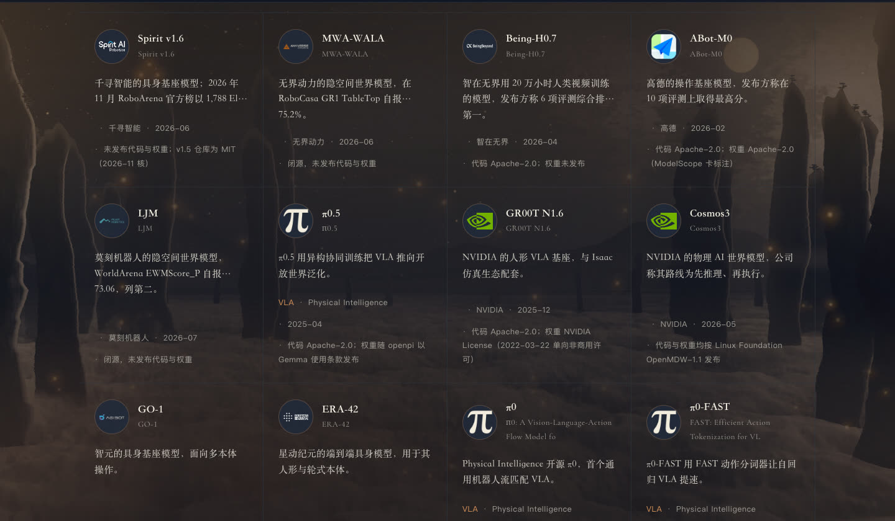
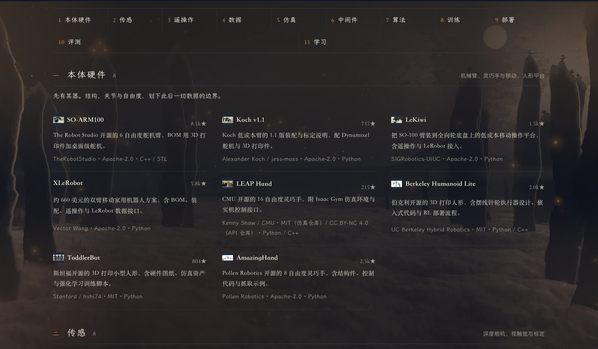
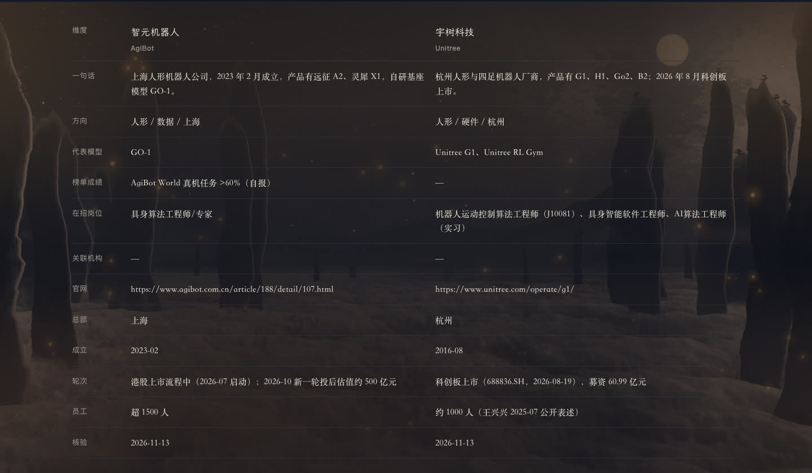
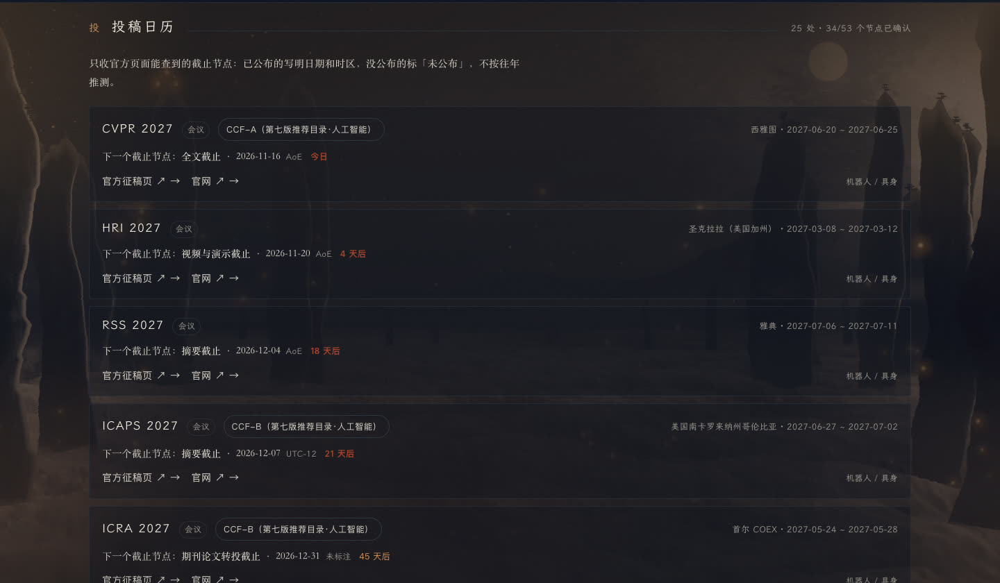

# 具身山海志

一个具身智能的中文资料站：公司、模型、榜单、岗位、开源资源，每条都附出处和核验日期。

[打开网站](https://fbddcz.github.io/Embodied-Shanhai-Atlas/) · [报错](https://github.com/FBddcz/Embodied-Shanhai-Atlas/issues/new?template=correction.yml) · [认领条目](https://github.com/FBddcz/Embodied-Shanhai-Atlas/issues/new?template=claim.yml) · [合作](https://fbddcz.github.io/Embodied-Shanhai-Atlas/coop.html)

## 为什么做

查具身行业的资料，常碰到这些事。一个模型说自己在某个榜上排第一，去官方榜上一查，没有它。一家公司说已经量产，却找不到一条交付记录。一个岗位挂了几个月，点进去，早就撤了。

消息其实都有，只是散在各处，也没人核对。这个站就想做个能核对的地方：把查过的整理到一起，每条附原文链接和核验日期。查不到的，空着，页面上写明为什么空。

名字取自《山海经》。那本书只记哪里有山、哪里有水、山里出什么，不评好坏。这里也照这个来，记事实，不排队。

## 站里有什么

| 板块 | 记什么 | 大约多少 |
|---|---|---|
| [公司](https://fbddcz.github.io/Embodied-Shanhai-Atlas/companies.html) | 档案、产品、融资经过、在招岗位、官方投递入口 | 一百五十家 |
| [研究机构](https://fbddcz.github.io/Embodied-Shanhai-Atlas/labs.html) | 负责人、研究方向、代表工作、孵化出的公司 | 六十所 |
| [模型](https://fbddcz.github.io/Embodied-Shanhai-Atlas/models.html) | 许可、参数、架构、训练数据、各榜成绩和对应测法 | 九十个 |
| [榜单](https://fbddcz.github.io/Embodied-Shanhai-Atlas/leaderboard.html) | 测法、评测协议、每行成绩的来历、已知问题 | 三十多个榜，上千行 |
| [本体与传感器](https://fbddcz.github.io/Embodied-Shanhai-Atlas/hardware.html) | 规格和规格出处、接口、价格、厂商自己的产品图 | 三百件 |
| [岗位](https://fbddcz.github.io/Embodied-Shanhai-Atlas/jobs.html) | 要求、面试流程、薪资口径、怎么准备，投递链接直通官网 | 几十个，下线的每天移走 |
| [开源资源](https://fbddcz.github.io/Embodied-Shanhai-Atlas/resources.html) | 代码、数据集、课程，写明怎么用、什么时候别用、上手多久 | 一百多项 |
| [动态](https://fbddcz.github.io/Embodied-Shanhai-Atlas/news.html) | 行业新闻，附原文 | 近百条 |

每个板块还有一个古称：公司叫人间，机构叫学宫，模型叫灵物，榜单叫碑林，岗位叫招贤，资源叫藏经，动态叫驿路。首页把七类内容画成海上七座岛，连线的两端是逐条核过的关系，比如一家公司发过什么模型，这个模型又上过哪些榜。

<table>
<tr>
<td width="50%"></td>
<td width="50%"></td>
</tr>
<tr>
<td align="center"><b>公司</b> · 标识取自各家官网</td>
<td align="center"><b>模型</b> · 按 VLA、世界模型、扩散策略等分类</td>
</tr>
<tr>
<td width="50%"></td>
<td width="50%"></td>
</tr>
<tr>
<td align="center"><b>本体</b> · 图片取自厂商自己的产品页</td>
<td align="center"><b>岗位</b> · 写明薪资口径</td>
</tr>
<tr>
<td width="50%"></td>
<td width="50%"></td>
</tr>
<tr>
<td align="center"><b>开源资源</b> · 按研发环节排列</td>
<td align="center"><b>条目页</b> · 先说它是什么，再列出处，最后写还没核实的地方</td>
</tr>
</table>

## 从哪里看起

| 你在做的事 | 先看 | 再看 |
|---|---|---|
| 做本体 | [公司](https://fbddcz.github.io/Embodied-Shanhai-Atlas/companies.html)、[本体与传感器](https://fbddcz.github.io/Embodied-Shanhai-Atlas/hardware.html) | 资源里遥操作和数据采集的部分 |
| 训模型 | [模型](https://fbddcz.github.io/Embodied-Shanhai-Atlas/models.html) | 对应的榜，先看测法再看分数 |
| 上真机 | [资源 · 控制](https://fbddcz.github.io/Embodied-Shanhai-Atlas/resources.html#stage-6) | 部署和评测，再看真机榜 |
| 找工作 | [岗位](https://fbddcz.github.io/Embodied-Shanhai-Atlas/jobs.html) | 资源里的课程，再看目标公司和实验室 |
| 跟进行业 | [动态](https://fbddcz.github.io/Embodied-Shanhai-Atlas/news.html) | [会议与投稿日历](https://fbddcz.github.io/Embodied-Shanhai-Atlas/events.html)，首页的榜单变动 |

## 收录规则

1. 有出处才收。每条事实附原文链接和核验日期。
2. 查不到就空着。不估算，不拿相近条目的数字来凑。
3. 分数要注明来历，每行成绩都带一个标签：
   - `官方榜`：评测方自己公布的
   - `自报`：发布方在论文或博客里说的，官方榜上没有
   - `平台复现`：第三方按同一协议重测的
   - `已撤榜`：官方收录后又撤下，原分数保留、划线，不删
4. 测法不同的分数不放在一起比。每个任务测几回、仿真还是真机、训练有没有用到同源数据，都分开记。
5. 配图只用官方的。本体和传感器用厂商产品页的图；模型大多没有官方图，那就空着，不拿相似的图顶替。
6. 自称要有证据。说量产，要查得到交付；说第一，要榜上有名。

## 十一关与九境

站里把一台机器从造出来到真正干活，拆成十一关：

> 铸体 · 通感 · 传功 · 聚灵 · 开境 · 御气 · 结丹 · 炼炉 · 出关 · 问碑 · 传灯

依次是本体、传感、遥操作、数据、仿真、控制、算法、训练、部署、评测、教学。

在这之上又分了九个境界，每一境有一道要过的检验，也写了最常卡住的地方。公司、模型各在哪一境，按公开能查到的事实推，不按自述。这一层是个比喻，用来标位置，不排名次。

九个境界分别是什么

| 境界 | 要做到 | 常见的卡点 |
|---|---|---|
| 窥径 | 画出整条链路，指出自己在哪一段 | 说不清上游交来的是数据还是指令 |
| 持器 | 说出手里机器的关节数、负载、接口 | 只会背宣传语，一问接口就答不上 |
| 察微 | 标定好相机、末端和力传感器 | 抓取总差几厘米，以为是模型的问题 |
| 引丝 | 按控制频率采一段连续轨迹 | 到训练时才发现丢帧、时间对不上 |
| 铸境 | 在仿真里复现手上的任务 | 仿真里能过，一上真机就失败 |
| 通脉 | 策略连续跑一段时间不掉频 | 一走一停，末端发抖 |
| 炼心 | 训出自己的策略，一条命令能复现 | 留了权重，没留配置 |
| 临阵 | 在真机上按固定协议跑多轮 | 只报成功的那几次 |
| 立碑 | 把成绩放上公开的榜 | 分数没有出处，或者早被撤下 |

总览页还按技术路线分了派系：端到端 VLA、分层双系统、世界模型先行、仿真合成、软硬一体等。每一派列了主张、代表团队，以及能查到的论文或公告。

## 其他功能

<table>
<tr>
<td width="50%"></td>
<td width="50%"></td>
</tr>
<tr>
<td valign="top"><b>全站搜索</b> 任意页面按 <kbd>⌘K</kbd>（Windows 上是 <kbd>Ctrl K</kbd>）或 <kbd>/</kbd>，公司、模型、榜单、岗位、论文一起搜，方向键选，回车打开。</td>
<td valign="top"><b>选型对比</b> 最多三家公司或三个模型放在一张表里比：方向、代表模型、榜单成绩、在招岗位、融资、规模。可以复制成文字，也可以分享链接。</td>
</tr>
<tr>
<td width="50%"></td>
<td width="50%"></td>
</tr>
<tr>
<td valign="top"><b>会议与投稿日历</b> 二十多个会议和期刊的截稿日期，写明时区，一个月内到期的标红。官网还没公布的就写「未公布」，不按往年推算。</td>
<td valign="top"><b>论文索引</b> arXiv 机器人方向的论文，每天补新的。可以按年月和分类筛，每篇附中文标题和摘要（机器翻译，以原文为准）。</td>
</tr>
</table>

另外还有：

- **山海图**：能拖、能缩放、能转。双击一座岛飞过去，点光点打开条目。键盘 <kbd>W</kbd><kbd>A</kbd><kbd>S</kbd><kbd>D</kbd> 转视角，<kbd>Tab</kbd> 逐个跳，<kbd>[</kbd> <kbd>]</kbd> 沿着相关条目走。
- **关注**：条目页点「关注」，收进「我的关注」。只存在你自己的浏览器里，不用注册。
- **游历印章**：逛过哪个板块，总览页上盖对应的章。
- **复制引用**：条目页一键复制，自带核验日期。
- **日夜与四季**：右上角切换日夜，默认跟随系统；背景随真实季节变，春天落花，冬天下雪。只改画面，不动内容。
- **RSS**：动态页有订阅地址。
- **手机**：每个页面都按手机重排过，榜单页在手机上用下拉框换榜。

## 怎么更新

每天早上一遍例行检查：

- 对官方榜单，哪个榜换了第一，首页的「碑林新刻」会记一笔
- 查岗位还在不在
- 收前一天 arXiv 的新论文
- 核对会议截稿日

能直接确定的变化自动录入。新闻、新岗位、配图这些要人判断的，只出草稿，看过才上线。

页面不写「最近更新」，每条只标自己的核验日期。三个月没复核的条目会单独列出来，等人重核。

## 报错与认领

- [报告错误](https://github.com/FBddcz/Embodied-Shanhai-Atlas/issues/new?template=correction.yml)：事实不对、链接失效、测法对不上、岗位已撤
- [认领条目](https://github.com/FBddcz/Embodied-Shanhai-Atlas/issues/new?template=claim.yml)：公司、机构、厂商的工作人员，可以补正自家条目。认领只改事实，站里的点评和榜单记录不因此改动。

每个条目页顶部也有「认领 / 纠错」，填完生成一段文字，直接贴进 Issue 就行。

合作相关的事看[合作页](https://fbddcz.github.io/Embodied-Shanhai-Atlas/coop.html)，有在线表单和交流群。

## 引用与许可

引用格式：

> 具身山海志（Embodied Atlas）· 核验日期 · 页面地址

条目字段、榜单成绩和山海图画面采用 [CC BY-NC-SA 4.0](LICENSE-DATA.md)：可以转载和改编，需要署名，不能商用，改编后的内容按同样的许可发布。网站代码和原创文字保留所有权利，商用请先联系。公司标识和产品图归各自所有者，详见[素材与许可](https://fbddcz.github.io/Embodied-Shanhai-Atlas/credits.html)。

## Star History

<a href="https://star-history.com/#FBddcz/Embodied-Shanhai-Atlas&Date">
  <picture>
    <source media="(prefers-color-scheme: dark)" srcset="https://api.star-history.com/svg?repos=FBddcz/Embodied-Shanhai-Atlas&type=Date&theme=dark" />
    <source media="(prefers-color-scheme: light)" srcset="https://api.star-history.com/svg?repos=FBddcz/Embodied-Shanhai-Atlas&type=Date" />
    
  </picture>
</a>
